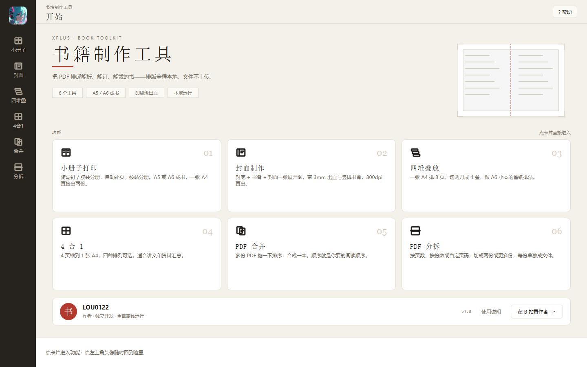

# 书籍制作工具（Book Toolkit）

把 PDF 排成能折、能订、能裁的书。原生桌面程序，**全程本地运行，文件不上传**。



## 功能

| 工具 | 做什么 |
|---|---|
| **书架** | 系列 → 卷 → 产物：拖一个文件夹进来，卷号自动排序；每本书七步状态、产物、定稿一目了然 |
| **生产线** | 一本书的七道工序节点图（导入→分割→封面→页码→排版→打印→定稿），点节点跳转到对应工具 |
| **分割** | 前 N 页 → 封面素材、末尾 M 页 → 封底素材，其余 → 正文；结果直接送进封面页的图槽 |
| **格式转换** | MOBI / AZW3 / EPUB / TXT → PDF（走 Calibre 的 ebook-convert），可选纸张/书型/字体/页边距 |
| **小册子打印** | 骑马钉 / 胶装分册；自动补 4 的倍数、按帖分册、末帖不会只剩 1 张纸；可选 A5 或 A6 成书 |
| **封面制作** | 封底 + 书脊 + 封面一张展开图，含 3mm 出血、竖排书脊、300/600 dpi；背景图可用图片，也可选 PDF 的某一页。**书脊厚度只认实测值**，填 0 不印书脊文字 |
| **四堆叠放** | 一张 A4 排 8 页，切两刀成 4 叠，做 A6 小本的省纸排法 |
| **4 合 1** | 4 页缩到 1 张 A4，四种排列，支持起始页 |
| **PDF 合并** | 多份 PDF 拖动排序后合并 |
| **PDF 分拆** | 按页数 / 按份数 / 自定义页码范围切成多份 |
| **加页码** | 底部居中 / 外侧 / 顶部外侧；起始页、跳过封面、字号、距边、奇偶镜像 |

其他：参数改完中间立刻重排、右侧纸张缩略图、起始页可翻原稿挑、长文件名不撑坏界面、**七页共用同一份文稿**（选一次到处能用）、参数和窗口位置自动记住、输出目录可改且重名不覆盖、处理中可取消、`Ctrl + Enter` 直接开始、出错带日志。

**打印记账**：真送印成功后自动记一笔（次数、张数、打印机、时间），生产线第⑥步随之变完成；
只打样张留痕但不算完成。排版重跑过则会标"需重跑"。

**批量**：小册子页可对整个文件夹的 PDF 按同一套参数逐个拼版。

**封面**：书名字体（宋体/黑体/雅黑/楷体）、颜色、封底文字、可选导出裁切线。

## 自测

改完代码先跑测试，全过才打包（`python build.py` 已内置）：

```bash
python tests/regression.py   # 内核：页序、张数、补白、A6、4合1、分拆、加页码、封面尺寸
python tests/real_books.py   # 真实书稿：四册 vs 已验收输出逐像素对拍
python tests/ui_smoke.py     # 界面：十二页能开、文件共享、真出文件
python tests/test_new_pages.py  # 新页：书架导入 / 生产线状态 / 分割出三个文件 / 封面联动
```

## 性能

拼版内核用 PyMuPDF：**206 页约 0.1 秒**（旧的 pypdf 实现约 13 秒）。

## 运行

环境：**Windows 10/11 + Python 3.11+**（打印链路走 winspool / SumatraPDF，目前只有 Windows）。

```bash
pip install -r requirements.txt
python run.py
```

打印功能需要先取一次打印引擎（GPLv3 的独立程序，不进本仓库）：

```bash
python tools/fetch_print_engine.py
```

没取也能启动、能拼版，只是点「开始打印」会提示组件缺失。

## 开发与自测

```bash
python build.py      # 先跑三套测试，全绿才打包到 dist/
```

单独跑某一套：

```bash
python tests/regression.py     # 拼版内核（页序、张数、补白、封面几何、辅助线逐像素）
python tests/ui_smoke.py       # 界面：十二页能开、缩略图真点、打印页选范围
python tests/test_new_pages.py # 书架→生产线→分割→封面联动→12 页全切一遍
python tests/real_books.py     # 可选：拿本地真实书稿与已验收输出逐像素对拍，缺书稿会自动跳过
```

## 打包

```bash
python build.py              # 测试 + PyInstaller onedir
python make_release.py       # release/ + 书籍制作工具-<ver>-portable-win64.zip
```

产物在 `dist/书籍制作工具/`，整个文件夹一起分发（`_internal` 是运行库）。发行版是**免安装绿色包**：解压即用，不写注册表（只写 `%LOCALAPPDATA%\XPlus\BookTool` 下的书架/日志/缩略图）。

版本号在两处，改包必须同步：`ui/app.py::APP_VERSION` 与 `make_release.py::VER`。

## 打印建议

- 双面打印、**短边翻转**、缩放 **100%**（不要选“适合页面”）
- 小册子沿中线对折，左半张往后翻，书脊在左
- 先打 1 张验：正面左 = 本册末页、右 = 第 1 页；背面左 = 第 2 页、右 = 倒数第 2 页
- A6 成书：一张 A4 上下各一份，先沿中线横切，两张各自对折装订

## 目录结构

```
run.py                 入口
core/pdfops.py         拼版内核（页序编排 + 页面摆放），不依赖 Qt
core/cover.py          封面渲染（PIL，四套版式 × 五套配色）
core/printpdf.py       送印（winspool 查打印机 + 调 SumatraPDF）
core/printlog.py       打印记账（写完进书架的 Project.prints）
core/pipeline.py       分割：封面素材 / 封底素材 / 正文
core/convert.py        格式转换（Calibre ebook-convert）
core/shelf/            书架数据层：系列→卷→产物、七步状态派生、原子写
ui/app.py              主窗口、导航、底部操作条、统一送印
ui/pages.py            七个传统工具页
ui/shelf_page.py       书架页
ui/pipeline_page.py    生产线七节点图
ui/split_page.py       分割页
ui/convert_page.py     格式转换页
ui/print_page.py       打印页
ui/home.py             首页
ui/widgets.py          通用控件（步进器、预览画布、文件卡…）
assets/                图标、作者头像、（不入库的）打印引擎
tests/                 四套自测
build.py               测试 → 打包
make_release.py        发布包 + zip
tools/                 取打印引擎、截图验收等小工具
docs/                  界面截图、合并记录
```

## 关于 promo/

`promo/` 是宣传片的制作工程（录屏驱动、剪辑、配音），**不属于程序本体**，也不随发行包分发。里面的成片与素材（含演示用的第三方书页）不随开源仓库发布，只保留脚本供参考。

## 许可

本项目以 **AGPL-3.0** 发布。原因是它依赖 [PyMuPDF](https://github.com/pymupdf/PyMuPDF)，该库采用 AGPL-3.0；分发本程序的二进制时，必须同时提供完整源码并保持同样的许可。

如果你要在闭源商业产品里使用，需要：
1. 向 Artifex 购买 PyMuPDF 商业授权，或
2. 把内核换成 pikepdf（MPL-2.0）等可闭源商用的库。

## 作者

LOU0122 · [B 站主页](https://space.bilibili.com/702283845)
